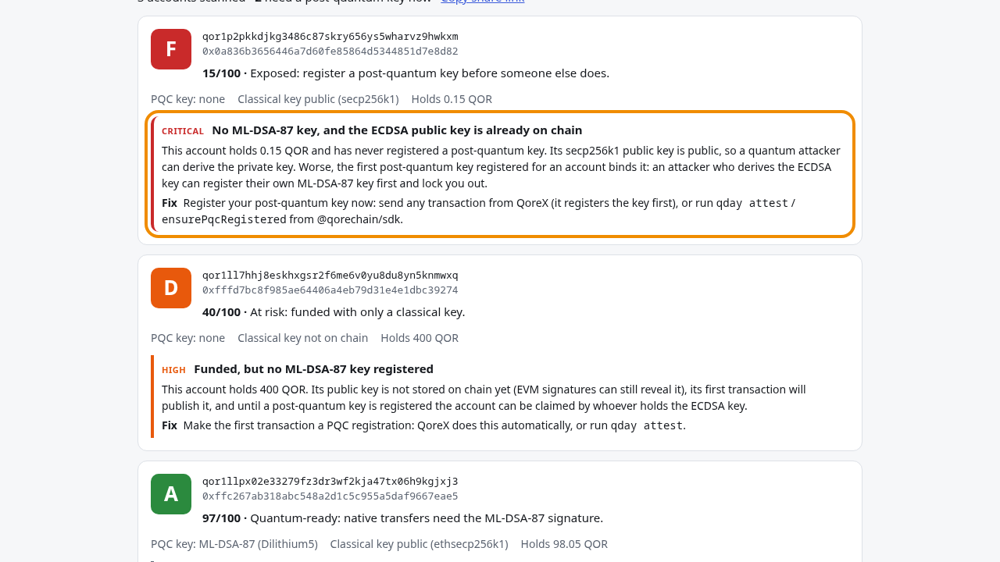
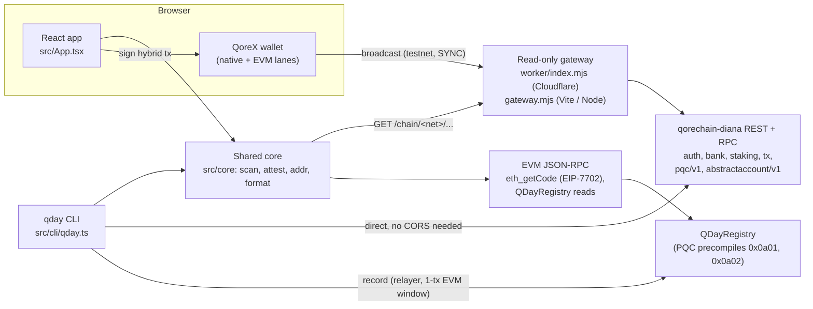

# Q-Day Readiness Audit

[](https://build.qorechain.io/p/q-day-readiness-audit)
[](https://github.com/apeirs/qday-readiness/actions/workflows/ci.yml)

Which QoreChain accounts would a quantum attacker take first? This tool scans any `qor1…` or `0x…` address on
QoreChain, scores how exposed it is, tells you the one thing to fix, and lets you prove your own account is
ready with a single hybrid-signed (secp256k1 + ML-DSA-87) transaction that anyone can verify.

It runs as a web app (scan, connect QoreX, attest, verify) and as a command-line tool (`qday`) for batch scans
and scripted attestations. Testnet (Diana, chain 9800) is the default; mainnet (Vladi) works for scans.

**Live demo: https://qday-readiness.apeir.workers.dev** ·
[Demo video (2:46)](https://github.com/apeirs/qday-readiness/releases/download/v0.1.0/qday-demo.mp4) ·
[Release v0.1.0](https://github.com/apeirs/qday-readiness/releases/tag/v0.1.0) ·
[Fest project page](https://build.qorechain.io/p/q-day-readiness-audit)



Try it: [scan three example testnet accounts](https://qday-readiness.apeir.workers.dev/?a=qor1p2pkkdjkg3486c87skry656ys5wharvz9hwkxm,qor1ll7hhj8eskhxgsr2f6me6v0yu8du8yn5knmwxq,qor1llpx02e33279fz3dr3wf2kja47tx06h9kgjxj3)
or [verify our attestation](https://qday-readiness.apeir.workers.dev/?tx=6B8EED3EC26B019CB9485BEFFC6B5F81DB04A59F54703A404DB539852ED045F8).
Both are also one click on the page: "Try examples (F, D, A)" and "Verify an example attestation".

## Judge quick path (about 3 minutes, no keys, no funds)

Node 22 or newer. Nothing below signs or sends a transaction.

```sh
git clone https://github.com/apeirs/qday-readiness && cd qday-readiness
npm ci
npm test                                   # unit + CLI tests, offline
npm run qday -- scan qor1p2pkkdjkg3486c87skry656ys5wharvz9hwkxm qor1ll7hhj8eskhxgsr2f6me6v0yu8du8yn5knmwxq 0xffc267ab318abc548a2d1c5c955a5daf9667eae5
#   grades F, D, A from live testnet; exits 1 on purpose because one account has a critical finding (CI-gate use)
npm run qday -- verify 6B8EED3EC26B019CB9485BEFFC6B5F81DB04A59F54703A404DB539852ED045F8
#   checks both signatures of our attestation against the signer's registered ML-DSA-87 key, and the QDayRegistry record
npm run build && npm start                 # the web app on http://127.0.0.1:8080
npx playwright install chromium && npm run test:e2e   # optional: the browser checks below, broadcasts blocked
```

## Quantum Pass requirements: where to find each one

| Requirement | Evidence |
|---|---|
| Use create-qorechain-dapp | Twice, both runs committed unmodified: the web app ([`7d74390`](https://github.com/apeirs/qday-readiness/commit/7d74390), 0.13.0, viem + wagmi template: `src/main.tsx`, `src/wagmi.ts`, the Vite setup) and [`contracts/`](contracts) ([`fbe93e3`](https://github.com/apeirs/qday-readiness/commit/fbe93e3), 0.13.1, evm-solidity template, which now holds QDayRegistry). `create-qorechain-dapp` is a pinned devDependency in [package.json](package.json); `npm run scaffold:contracts` is the exact command |
| Connect QoreX | RainbowKit + `@qorechain/qorex-rainbowkit` for the EVM lane, `@qorechain/qorex-types` for the native lane ("Scan my wallet", "Attest with QoreX"): [`src/qorex.ts`](src/qorex.ts) |
| Deploy on testnet | Contract **QDayRegistry** at [`0xfcDd726E5cAeb40df793560F3FbbdBC669F0354A`](https://explore.qore.network/address/0xfcDd726E5cAeb40df793560F3FbbdBC669F0354A) on `qorechain-diana` (EVM 9800), deploy tx [`0xbf86da97…`](https://explore.qore.network/tx/0xbf86da9725961930daad2c38e157071b7f746f13b4e3a64ca285312abe3ca999). The app's Verify reads it; both attestations below are recorded in it. Plus the hosted app at https://qday-readiness.apeir.workers.dev |
| One hybrid-signed transaction | Two: [`6B8EED3E…`](https://qday-readiness.apeir.workers.dev/?tx=6B8EED3EC26B019CB9485BEFFC6B5F81DB04A59F54703A404DB539852ED045F8) (web app) and [`3DC0994B…`](https://qday-readiness.apeir.workers.dev/?tx=3DC0994B1BFF78D1ECA2D90CFCE02DF08CA54A0FDADAFA87BB23A6C769D2113B) (CLI), each verified in the app with QoreSign |
| Repo, README, MIT licence, featured image, video <= 3 min, testnet address | This repo, [LICENSE](LICENSE), [docs/featured.png](docs/featured.png), [qday-demo.mp4 (2:46)](https://github.com/apeirs/qday-readiness/releases/download/v0.1.0/qday-demo.mp4), `qor1ay8cveqak7yx8wd4us9mk8q7eak3dj56nz545m` |
| Credits for kits and libraries | [Built with](#built-with) |

## On QoreChain testnet

Network: `qorechain-diana` (testnet, chain 9800).

| What | Value |
|---|---|
| Testnet address used | `qor1ay8cveqak7yx8wd4us9mk8q7eak3dj56nz545m` |
| Hybrid-signed attestation, web app "Attest with QoreX" (QoreX wallet mock) through the Worker gateway (block 9,934,842) | [`6B8EED3EC26B019CB9485BEFFC6B5F81DB04A59F54703A404DB539852ED045F8`](https://qday-readiness.apeir.workers.dev/?tx=6B8EED3EC26B019CB9485BEFFC6B5F81DB04A59F54703A404DB539852ED045F8) · [raw JSON](https://api-testnet.qore.host/cosmos/tx/v1beta1/txs/6B8EED3EC26B019CB9485BEFFC6B5F81DB04A59F54703A404DB539852ED045F8) |
| Hybrid-signed attestation, `qday attest` CLI (block 9,934,042) | [`3DC0994B1BFF78D1ECA2D90CFCE02DF08CA54A0FDADAFA87BB23A6C769D2113B`](https://qday-readiness.apeir.workers.dev/?tx=3DC0994B1BFF78D1ECA2D90CFCE02DF08CA54A0FDADAFA87BB23A6C769D2113B) · [raw JSON](https://api-testnet.qore.host/cosmos/tx/v1beta1/txs/3DC0994B1BFF78D1ECA2D90CFCE02DF08CA54A0FDADAFA87BB23A6C769D2113B) |
| ML-DSA-87 key registration for that address (block 9,934,040) | `CFE50F413E357E7501E0468FE8E6939F87D6D2B807B24FB192DCF5C927B587B3` |
| **QDayRegistry contract** ([source](contracts/contracts/QDayRegistry.sol), solc 0.8.24) | [`0xfcDd726E5cAeb40df793560F3FbbdBC669F0354A`](https://explore.qore.network/address/0xfcDd726E5cAeb40df793560F3FbbdBC669F0354A) |
| QDayRegistry deploy tx (EVM block 9,939,292, 1,292,574 gas) | [`0xbf86da9725961930daad2c38e157071b7f746f13b4e3a64ca285312abe3ca999`](https://explore.qore.network/tx/0xbf86da9725961930daad2c38e157071b7f746f13b4e3a64ca285312abe3ca999) |
| `record()` of the CLI attestation `3DC0994B…` (EVM block 9,939,321) | `0xf14e23ccc924bb408acb8b5aa22d373f11381659be810fad734edf9499674e7e` |
| `record()` of the web attestation `6B8EED3E…` (EVM block 9,939,327), the latest on record | `0xf2f00a845987222cf57973b6adb42fb6f1585e03156451aa9f23163d3bdddc34` |
| Relayer that sent them (Ethereum-type account of the same key file) | `qor15r530mn85m37hvzu5cfq7k39ry0e8u40yln0jh` / `0xa0e917Ee67A6e3EBB05ca6120f5A25191F93f2AF` |

Both attestations carry the memo `qday:v1;qor1ay8cveqak7yx8wd4us9mk8q7eak3dj56nz545m;A;100;70b31e56bd69` and pass
all four signature and memo checks: committed, secp256k1 signature, ML-DSA-87 signature against the registered key
(sign-bytes v2), and the memo. The fifth row, "Recorded in QDayRegistry", passes for `6B8EED3E…` and shows
`3DC0994B…` as replaced by that newer one. On chain, `isReady(0xe90f86641db78863b9b5e40bbb1c1ecf6d16ca9a, 90)`
returns `true`. Re-check either one with `npm run qday -- verify <hash>` or the links above. The QoreChain explorers
open on mainnet by default: switch them to Testnet to see these transactions.

## Video and stills

Silent screen recording of the live app with captions, 2:46, attached to [release v0.1.0](https://github.com/apeirs/qday-readiness/releases/tag/v0.1.0):

- [qday-demo.mp4](https://github.com/apeirs/qday-readiness/releases/download/v0.1.0/qday-demo.mp4): the three steps and the live PQC policy line, one-click examples graded F/D/A, the registered-key checks, share link, QoreX scan, attestation, one-click example verify (incl. QDayRegistry), CLI as a CI gate
- [still-grade-F.png](https://github.com/apeirs/qday-readiness/releases/download/v0.1.0/still-grade-F.png) ·
  [still-attest-real.png](https://github.com/apeirs/qday-readiness/releases/download/v0.1.0/still-attest-real.png) ·
  [still-verify.png](https://github.com/apeirs/qday-readiness/releases/download/v0.1.0/still-verify.png) ·
  [still-cli.png](https://github.com/apeirs/qday-readiness/releases/download/v0.1.0/still-cli.png) ·
  [still-grade-A-key.png](https://github.com/apeirs/qday-readiness/releases/download/v0.1.0/still-grade-A-key.png)

In the video the wallet is QoreChain's `@qorechain/qorex-wallet-mock` (the QoreX provider used for browser tests),
and the attestation shown was sent with `qday attest`. For the one-click examples shot the browser's network latency
was raised so the cards can be seen filling in.

## Why it matters

QoreChain protects an account with a post-quantum key only after that key is registered. Until then the account
is guarded by ECDSA alone. Once its public key is on chain (after any transaction, or from an EVM signature), a
large enough quantum computer can derive the private key. And the first ML-DSA-87 key registered for an account
binds it: an attacker who has derived the ECDSA key could register their own post-quantum key first and lock
the owner out for good. The fix is cheap and one-time, but you have to know which of your accounts still need it.

## What it checks

| Check | Source | Effect on the score |
|---|---|---|
| ML-DSA-87 key registered | `qorechain/pqc/v1/account` | Missing on a funded account with a public ECDSA key: **critical** (-85) |
| Funded, key not yet published | `cosmos/auth`, `cosmos/bank`, `cosmos/staking` | **high** (-60) |
| Empty account without a PQC key | `cosmos/auth` | low (-25) |
| Address the chain has never seen | `cosmos/auth`, `cosmos/bank` | info (-15): safe until funded, but without a post-quantum key it cannot grade A |
| Proof of possession at registration | `possession_proven` | info (-3) |
| Open EVM authorisation window | `qorechain/pqc/v1/evm_window` | -5 if scoped to targets, -15 if not |
| EIP-7702 delegation | `eth_getCode` (`0xef0100…`) | -10 (-2 if the delegate has no code) |
| Extra authenticators on an abstract account | `qorechain/abstractaccount/v1` | -5 |
| Registered key is a real ML-DSA-87 key | `qorechain/pqc/v1/account` `public_key` | must be 2,592 bytes (FIPS 204); otherwise **high** (-40). The card shows the size and a SHA-256 fingerprint to compare with your wallet |
| Registered key can be forged | `qorechain/pqc/v1/account` `public_key` | **critical** (-85) when everything after the 32-byte seed (the t1 part) is zero: such a key accepts a signature made with no secret at all (`test/core.test.ts` builds one and checks it with the SDK's `pqcVerify`). Same rule as the SDK's `isDegeneratePqcPublicKey` |
| PQC key bound to the account's own classical key | `ecdsa_pubkey` vs the `cosmos/auth` public key | low (-5) if they differ |
| The network actually enforces the PQC key | `qorechain/pqc/v1/params` (`hybrid_signature_mode`, `allow_classical_fallback`) | medium (-20) on registered accounts if hybrid signatures are not required or classical-only fallback is on |
| Contracts and module accounts | `eth_getCode`, account type | not scored: no key to protect |

The network policy is read once per scan batch and shown above the scanner (today both Diana and Vladi report
hybrid signatures **required**, classical-only fallback **off**, ML-DSA-87 at NIST level 5), and the CLI prints it
on its first line. Readiness is 100 minus exposure. Grades: A ≥ 90, B ≥ 75, C ≥ 50, D ≥ 25, F below. Balances include the fest
tokens (fUSD, fETH, fBTC), which the chain keeps as `erc20:` bank denoms.

## The attestation

`Attest with QoreX` (web) or `qday attest` (CLI) sends 0.000001 QOR from the account to itself with a memo:

```
qday:v1;<qor1 address>;<grade>;<readiness>;<first 12 hex of the SHA-256 of the scan>
```

QoreChain requires every native transaction to carry an ML-DSA-87 signature next to the classical one, so the
transaction itself is the proof. If the key is not registered yet, QoreX (or the CLI, via `ensurePqcRegistered`)
registers it first. `Verify` and `qday verify <txhash>` check both signatures with
[`@qorechain/qoresign`](https://www.npmjs.com/package/@qorechain/qoresign) against the signer's registered key and
decode the memo. Share a result with `?tx=<hash>`; share a scan with `?a=<addr>,<addr>`.

Fees: about 0.15 QOR the first time (registration plus the attestation), about 0.06 QOR after that.

## QDayRegistry: the on-chain record

[`contracts/contracts/QDayRegistry.sol`](contracts/contracts/QDayRegistry.sol), deployed on testnet at
[`0xfcDd726E5cAeb40df793560F3FbbdBC669F0354A`](https://explore.qore.network/address/0xfcDd726E5cAeb40df793560F3FbbdBC669F0354A), keeps each account's latest attestation where contracts
can read it: `isReady(account, minReadiness)` is a one-line gate for anything that should only serve
quantum-ready accounts. It trusts no one who relays to it. `record(account, signBytes, pqcSignature, nativeTx)`:

1. reads the account's key from QoreChain's PQC Key Status precompile (`0x…0a02`) and requires a registered
   ML-DSA-87 key with a proof of possession;
2. checks the ML-DSA-87 signature over the transaction's hybrid sign-bytes (v2) with the PQC Verify precompile
   (`0x…0a01`), the same check the chain ran when it accepted the transaction;
3. parses the sign-bytes itself: the chain id must be `qorechain-diana`, the memo (TxBody field 2) must be a
   `qday:v1` memo naming this very account in bech32, and the signer's sequence comes from the AuthInfo;
4. accepts only a newer sequence than the one on record, so an old attestation can't replace a newer one.

So a record exists only if the account's own post-quantum key signed that grade, and anyone can relay it. `isReady`
also re-checks that the account still holds the same proven key. A wrong signature, a changed byte or another
account's key reverts (simulated on testnet before the deploy).

Why a relay step: QoreX signs native transactions but has no EVM signing yet, and an account made from a Cosmos
key (`m/44'/118'`) can't send EVM transactions as itself. So the web app's Attest stays a native transaction, and
`qday attest` (or `qday record <txhash>` for any account's attestation) relays it from the Ethereum-type account of
the same key file. Each EVM write first opens a one-transaction EVM window with a hybrid-signed native message,
limited to the fee it needs and, for a record, to the registry as the only target. The contract lives in the
`contracts/` package that create-qorechain-dapp scaffolded; `npm run compile:contracts` rebuilds
`QDayRegistry.artifact.ts` with solc 0.8.24, and CI fails if the committed artifact differs from the source.

## Architecture



| Path | What it does |
|---|---|
| `src/core/scan.ts` | Reads chain state, `assess()` turns it into findings, exposure and grade (pure, unit-tested) |
| `src/core/attest.ts` | Builds the `qday:v1` memo; verifies a tx's secp256k1 + ML-DSA-87 signatures with QoreSign |
| `src/core/registry.ts` | Reads QDayRegistry over EVM JSON-RPC for Verify's "Recorded in QDayRegistry" row |
| `contracts/` | create-qorechain-dapp evm-solidity scaffold: `QDayRegistry.sol`, its compiled artifact, `scripts/compile.mjs` |
| `src/cli/registry.ts` | CLI: deploy QDayRegistry, relay attestations (EVM window, then the EVM tx) |
| `src/core/addr.ts` | `qor1` <-> `0x` conversion and input parsing |
| `src/App.tsx`, `src/qorex.ts` | Web app; QoreX connect, key registration + attestation through the wallet |
| `src/cli/qday.ts`, `src/cli/signer.ts` | CLI; key files (0600), `ensurePqcRegistered` + hybrid `MsgSend` with `@qorechain/sdk` |
| `worker/index.mjs`, `gateway.mjs` | Same-origin gateway: GET allowlist, path-trick refusals, one testnet broadcast route |
| `test/` | Scoring, key and policy checks, memo, address parsing, gateway and Worker behaviour |

Nothing is stored server-side: the Worker has no KV, database or secrets, and the app keeps state only in the URL
(`?a=` for scans, `?tx=` for attestations).

## Run the web app

```sh
npm install
npm run dev            # http://localhost:5173
npm run build && npm start   # production build served on http://127.0.0.1:8080 (PORT, HOST)
```

QoreChain's REST and Tendermint RPC endpoints send no CORS headers, so the app reads them through a small
read-only gateway (`gateway.mjs`) that the dev server and `server.mjs` both mount at `/chain/<network>/…`. It
forwards GET requests on an allowlist (`cosmos/auth|bank|staking|tx|upgrade`, `qorechain/pqc|abstractaccount`,
RPC `/tx` and `/status`), plus one write route: `POST /chain/testnet/rest/cosmos/tx/v1beta1/txs` for wallets that
broadcast through the page's REST endpoint. That route takes only a JSON body of at most 64 KB holding `tx_bytes`
and `mode: BROADCAST_MODE_SYNC`, relays it to testnet and passes the chain's answer back unchanged; the body is
never logged or stored. Every other write is refused (405). The EVM JSON-RPC allows CORS and is called directly.

## Deploy

The hosted demo is one Cloudflare Worker: Workers Static Assets serve the built app, and `worker/index.mjs`
runs the same gateway at `/chain/<network>/…` (same allowlist and broadcast checks as `gateway.mjs`, redirects
refused, 15 s upstream timeout). Nothing else is created: no KV, database or secrets.

```sh
npx wrangler login     # once (or export CLOUDFLARE_API_TOKEN with "Workers Scripts: Edit" + CLOUDFLARE_ACCOUNT_ID)
./deploy.sh            # tests, build, secret check, then `wrangler deploy` -> https://qday-readiness.<account>.workers.dev
./deploy.sh --dry-run  # same checks, bundles the Worker, uploads nothing
npm run cf:dev         # the Worker locally on http://127.0.0.1:8787 (after `npm run build`)
```

`scripts/check-secrets.sh` runs before every deploy and stops it if a key file, mnemonic or credential could be in
`dist/` or in the tracked files. Successful chain reads are cached at the edge for 15 s (account state) or a day
(committed transactions); errors and "not found" answers are never cached. Static files under `/assets/` are
content-hashed and cached for a year (`public/_headers`). To self-host instead, `npm run build && npm start` runs
the same app and gateway with Node and no dependencies.

## Command line

```sh
npm run qday -- scan qor1p2pkkdjkg3486c87skry656ys5wharvz9hwkxm 0xffc267ab318abc548a2d1c5c955a5daf9667eae5
npm run qday -- scan --file treasury.txt --json      # one address per line, # starts a comment
npm run qday -- verify 6B8EED3EC26B019CB9485BEFFC6B5F81DB04A59F54703A404DB539852ED045F8
npm run qday -- keygen --key ~/.qday/testnet.key     # new testnet key, file mode 0600, prints addresses only
npm run qday -- whoami --key ~/.qday/testnet.key
npm run qday -- attest --key ~/.qday/testnet.key --dry-run   # build and check the hybrid tx offline
npm run qday -- attest --key ~/.qday/testnet.key             # register if needed, attest, relay to QDayRegistry
npm run qday -- record 6B8EED3EC26B019CB9485BEFFC6B5F81DB04A59F54703A404DB539852ED045F8 --key ~/.qday/testnet.key
npm run qday -- deploy-registry --key ~/.qday/testnet.key    # deploy your own QDayRegistry
```

`scan` exits 1 when any account has a critical finding, so it can gate a CI job or a treasury check.
`--network mainnet` scans mainnet; `attest` refuses to run without enough balance and says how much it needs.
Key files that other users can read are refused. `whoami` also checks, offline, how the registered ML-DSA-87 key
was made: bound to the address (SDK 0.13+, QoreX), from the mnemonic only, or derived from the ECDSA private key
(SDK before 0.13.0 with `unifiedAccountFromSeed`). The last one means whoever recovers the ECDSA key also has the
post-quantum key, so `whoami` exits 1 and says to rotate. Unknown commands exit 2.

## Tests

```sh
npm test           # scoring (incl. a forged ML-DSA-87 signature against a zero-t1 key), address parsing, memo format,
                   # CLI errors and key-origin checks, gateway allowlist + Worker (path tricks, methods, broadcast route, cache)
npm run build      # type-check and production build
npm run test:e2e   # after the build: Playwright drives the built app in Chromium (CHROME=/path/to/chrome to reuse one)
```

`test:e2e` ([test/e2e/browser.mjs](test/e2e/browser.mjs)) checks the one-click examples (F, D, A) in light at
desktop width and dark at phone width, a never-seen address, the `?tx=` verify link, and QoreX through
`@qorechain/qorex-wallet-mock` with a fresh throwaway key: "Scan my wallet" scans that account and "Attest with
QoreX" stops before signing because it holds 0 QOR. Every transaction broadcast is blocked and counted; the run
fails if the page tries one.

[GitHub Actions](.github/workflows/ci.yml) runs the tests, the build, the secret check, a Worker dry-run bundle and a recompile of QDayRegistry (the committed artifact must match the source) on
every push, plus `qday scan` on our own testnet account as an example of the CLI used as a CI gate.

## Not the QoreX "Q-Day Scanner"

The QoreX mobile wallet has a built-in Q-Day Scanner for the wallet's own accounts. This tool is separate: it
scans any address, including ones you don't hold keys for (a treasury, a validator's operator account, a
contract's owner), works in batches from the command line, and records a verifiable on-chain attestation.

## Built with

QoreChain kits and template:

- [create-qorechain-dapp](https://www.npmjs.com/package/create-qorechain-dapp) 0.13.0, viem + wagmi template (web app
  scaffold), and 0.13.1, evm-solidity template (`contracts/`)
- [`@qorechain/sdk`](https://www.npmjs.com/package/@qorechain/sdk): hybrid signing, `ensurePqcRegistered`,
  `EthNativeSigner`, `openEvmWindowMsg`
- [`@qorechain/evm`](https://www.npmjs.com/package/@qorechain/evm): `qor1` / `0x` address conversion, EVM client,
  EVM window status
- QoreChain PQC precompiles `pqcVerify` (`0x…0a01`) and `pqcKeyStatus` (`0x…0a02`), called from QDayRegistry
- [`@qorechain/qoresign`](https://www.npmjs.com/package/@qorechain/qoresign): secp256k1 + ML-DSA-87 signature verification
- [`@qorechain/qorex-types`](https://www.npmjs.com/package/@qorechain/qorex-types) and
  [`@qorechain/qorex-rainbowkit`](https://www.npmjs.com/package/@qorechain/qorex-rainbowkit): QoreX
- [`@qorechain/qorex-wallet-mock`](https://www.npmjs.com/package/@qorechain/qorex-wallet-mock): QoreX provider for browser tests

Open source libraries:
[React](https://react.dev) (MIT), [Vite](https://vite.dev) and `@vitejs/plugin-react` (MIT),
[wagmi](https://wagmi.sh) and [viem](https://viem.sh) (MIT), [RainbowKit](https://rainbowkit.com) (MIT),
[TanStack Query](https://tanstack.com/query) (MIT), [CosmJS](https://github.com/cosmos/cosmjs)
(`@cosmjs/stargate`, `proto-signing`, `encoding`; Apache-2.0), [cosmjs-types](https://github.com/confio/cosmjs-types)
(Apache-2.0), [TypeScript](https://www.typescriptlang.org) (Apache-2.0), [tsx](https://github.com/privatenumber/tsx)
(MIT), [Wrangler](https://github.com/cloudflare/workers-sdk) (MIT OR Apache-2.0) and Cloudflare Workers for hosting,
[Playwright](https://playwright.dev) (Apache-2.0) for the browser tests ([test/e2e](test/e2e)), [solc-js](https://github.com/ethereum/solc-js)
0.8.24 (MIT; the Solidity compiler is GPL-3.0) for the contract.

## Licence

[MIT](LICENSE) © 2026 apeir. Built for Build Before Q-Day, the QoreChain Developer Fest (Quantum Pass). #BuildBeforeQDay
